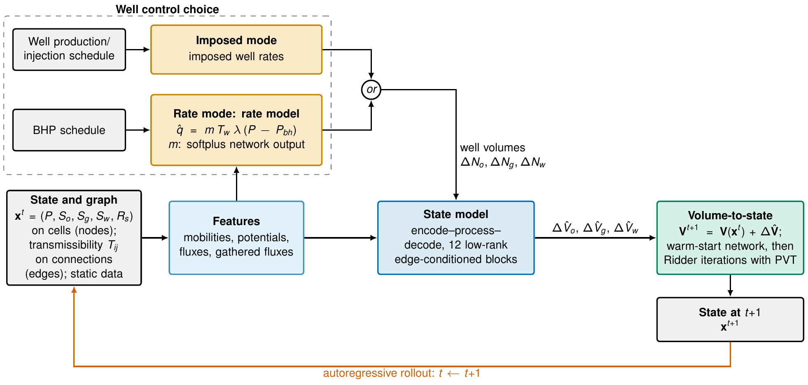
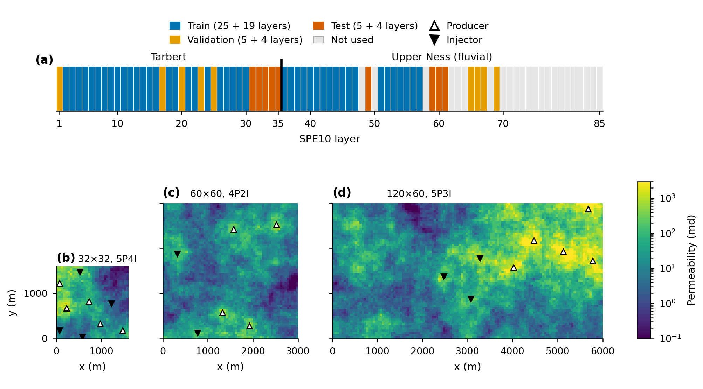
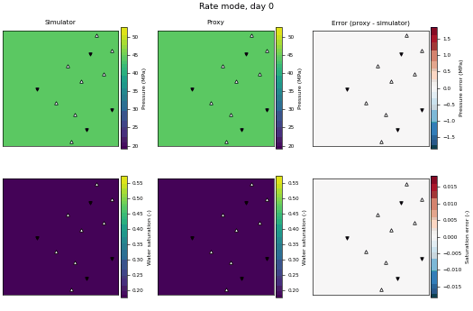

# ResFlow-GNN

ResFlow-GNN is a graph neural network proxy for multiphase (black-oil) reservoir flow simulation. Given the state of the
reservoir (pressure, saturations, dissolved gas in every cell), the static grid data and the well controls, it predicts the
next day's state, and chained day by day it reproduces a 1,825-day waterflood. It handles different geological models and
grid sizes, a variable number and position of wells, and well controls that change in time, and can start from any state. A
second, small network (the rate model) predicts the well volumes from the state and the prescribed bottom-hole pressures, so
the proxy can run from the controls alone. This repository holds the code to build the simulation decks, convert simulator
results to training data (IMEX or the open-source OPM Flow), train, fine-tune and roll out the models, the trained weights,
and the results of the paper.

Paper: T. C. A. Amorim and D. J. Schiozer, *ResFlow-GNN: A Graph Neural Network Proxy for Multiphase Reservoir Flow*, manuscript to be submitted.



*Rollout loop (paper Fig. 1): the state model predicts the volume increments of one day; the well volumes are imposed from a
simulation or predicted by the rate model.*



*Data (paper Fig. 2): SPE10 layers split into training, validation and test sets (Tarbert, and Upper Ness for the fluvial set),
and example 32x32, 60x60 and 120x60 test patches with their wells.*

## Example

Rate mode (only the BHP schedule is given) on a 60x60 test case with 8 producers and 4 injectors: pressure and water
saturation, simulator, proxy and error, every 46 days to day 1825.



The animation shows a rollout of the shipped weights on IMEX results (made with `resflow.plotting` and matplotlib).

## Results

Test-set medians at day 1825 (`results/final_model/summary.csv`; 95 % bootstrap intervals, all cases and figures are in
`results/final_model/`). Imposed: the simulator's well volumes drive the state model. Rate: the rate model predicts them.
P is pressure, MAE in MPa; |MBe oil| is the absolute oil material-balance error in %. The Upper Ness set is evaluated
with the Tarbert model without fine-tuning (the fine-tuned results are in the paper).

| Test set | Mode | Cases | P R2 | Sw R2 | P MAE (MPa) | Sw MAE | MBe oil (%) |
|---|---|---|---|---|---|---|---|
| Tarbert 32x32 | rate | 18 | 0.9998 | 0.9998 | 0.084 | 0.0007 | 0.36 |
| Tarbert 32x32 | imposed | 18 | 0.9960 | 0.9998 | 0.409 | 0.0008 | 0.04 |
| Tarbert 60x60 | rate | 15 | 0.9997 | 0.9998 | 0.085 | 0.0006 | 0.22 |
| Tarbert 60x60 | imposed | 15 | 0.9948 | 0.9996 | 0.406 | 0.0007 | 0.04 |
| Tarbert 120x60 | rate | 15 | 0.9992 | 0.9991 | 0.165 | 0.0008 | 0.18 |
| Tarbert 120x60 | imposed | 15 | 0.9810 | 0.9989 | 0.887 | 0.0011 | 0.17 |
| Upper Ness 32x32 (no fine-tuning) | rate | 15 | 0.7755 | 0.8913 | 1.638 | 0.0137 | 2.97 |
| Upper Ness 32x32 (no fine-tuning) | imposed | 15 | -0.2654 | 0.8162 | 9.200 | 0.0204 | 2.75 |

A rerun gives close, not identical numbers (the paper's rollouts used non-deterministic GPU kernels; see
[docs/06](docs/06_run_trained_model.md)). The 32x32 row of 18 cases excludes the two single-producer (1P0I) cases, reported
separately in `summary.csv`.

## Quickstart

Python 3.12 is required (details in [docs/00_install.md](docs/00_install.md)).

```bash
# 1. install (CPU build of torch shown; see docs/00 for CUDA)
python3.12 -m venv .venv && source .venv/bin/activate
pip install torch==2.5.1 --index-url https://download.pytorch.org/whl/cpu
pip install torch_geometric==2.7.0
pip install -e .

# 2. download the demo data (OPM Flow results of 6 test decks, about 160 MB download, 420 MB unzipped)
python scripts/download_demo.py --out _data/demo

# 3. build the dataset and roll out the shipped weights in rate mode (`--device cuda` if you have a GPU)
resflow build --root _data/demo/spe10
resflow rollout --weights weights/state_2d_1d --rate-weights weights/rate_2d_1d \
    --dataset _data/demo/spe10 --out _data/rollouts/rate --device cpu

# 4. plot the maps and the well curves
python - <<'PY'
from resflow import plotting as P
from resflow.plotting import style
days = (365, 1000, 1825)
style.setup(110)
sim = "L33_32X32_01_8P4I_VARIABLE.DATA"
ro = P.read_rollout_npz(f"_data/rollouts/rate/rollout_{sim}.npz", days=days)
style.save(P.plot_state_maps(P.state_fields(ro), days, ro.ijk, (ro.marker_ij, ro.marker_type, ro.marker_name)), "maps.png", 110)
style.save(P.plot_cumulative(P.read_cumulative_csv(f"_data/rollouts/rate/rollout_cumulative_{sim}.csv")), "wells.png", 110)
PY
```

Step 3 rolls out every deck of the set (a few minutes per deck on a GPU); see the
[tutorial](docs/09_tutorial.md) for a single deck, the comparison with the true data and the imposed mode.

## Repository map

| Path | Content |
|---|---|
| `resflow/` | the package: `io` (IMEX and OPM readers), `preprocess`, `data`, `models` (state and rate GNN), `physics`, `train`, `rollout`, `plotting`, `cli.py` |
| `deck_builder/` | builds the simulation decks (SPE10 patches, wells, BHP schedules) for IMEX, OPM Flow or open-DARTS; ships the well layouts of the paper |
| `configs/` | YAML training recipes (state 1-day and 10-day, 3D, rate, fluvial fine-tune) |
| `weights/` | shipped trained models: 2D state, 2D rate, fluvial fine-tuned state |
| `results/final_model/` | metrics and figures of the 65 test cases of the paper, both modes |
| `scripts/` | `download_demo.py` (demo data from Zenodo), `upload_zenodo.py` (draft deposit of the demo data, for maintainers) |
| `docs/` | the guides below |
| `tests/` | pytest suite |

## Documentation

| Page | Topic |
|---|---|
| [00_install.md](docs/00_install.md) | installation, OPM Flow |
| [02_build_decks.md](docs/02_build_decks.md) | build the simulation decks (the paper's 3,142 decks, or your own) |
| [03_run_simulators.md](docs/03_run_simulators.md) | run the decks with IMEX, OPM Flow or open-DARTS |
| [04_opm_conversion.md](docs/04_opm_conversion.md) | training data from OPM Flow results, differences with IMEX |
| [05_train.md](docs/05_train.md) | train the state and rate models |
| [06_run_trained_model.md](docs/06_run_trained_model.md) | rollouts, outputs, plots, comparison with the paper |
| [07_extensions.md](docs/07_extensions.md) | 10-day and 3D models, fine-tuning on the fluvial set |
| [08_reference.md](docs/08_reference.md) | user guide: every command, option, config key, file format and expected output |
| [09_tutorial.md](docs/09_tutorial.md) | step by step on the demo data |

There is no page 01: the numbering follows the workflow figure.

## Two data paths

| | IMEX (the paper) | OPM Flow (open source) |
|---|---|---|
| Simulator | CMG IMEX (commercial licence) | OPM Flow 2026.04 or newer (`pip install opm opm-simulators`, Linux x86_64; WSL on Windows) |
| Decks | `deck_builder` | the same decks, converted by `deck_builder/cmg_to_opm.py` |
| Converter | `resflow convert --format imex` | `resflow convert --format opm` |
| Status | the shipped weights were trained on IMEX results; the paper's numbers come from here | the full pipeline works without a licence; the demo data are OPM results |

The two simulators differ slightly (see [docs/04](docs/04_opm_conversion.md)): in rate mode the shipped weights reproduce
OPM data as well as IMEX data; in imposed mode the OPM water production of near-dry producers shifts the pressure level.

## Computational requirements

- Python 3.12, PyTorch 2.5.1, PyTorch Geometric 2.7.0 (`requirements.txt`); Linux, or WSL2 on Windows.
- **Rollouts** run on a GPU or a CPU. Paper timings (one NVIDIA Tesla V100, 1-day model, 27 single-layer test cases):
  6.0 to 9.5 s per 100 simulated days with imposed rates, 7.8 to 11.0 s with the rate model, i.e. about 2 to 3.5 min for
  a 1,825-day rollout. The 10-day model is about ten times faster (0.63 to 3.1 s per 100 days on single-layer grids, up to
  18.6 s on the 462,000-cell deck, peak GPU memory 21 GB).
- **Training needs a GPU.** The paper's models were trained on one workstation (AMD Ryzen 9 9950X, 64 GB RAM, NVIDIA GeForce
  RTX 4070 Ti SUPER with 16 GB, Linux under WSL2): the state model for 12 epochs of 108,000 steps, about 4 days, and the
  rate model for 7 epochs of 182,106 steps. 16 GB of GPU memory is enough.
- Disk: the demo data are about 160 MB to download and 420 MB unzipped (plus about 550 MB if you build all six decks).

## Data availability

The simulation results of the paper were made with CMG IMEX, a commercial simulator whose licence does not allow us to
share its results (`.sr3` files); for the same reason no data converted from IMEX results are published. What is shared:

- the **deck builder** and the paper's well layouts: all 3,142 decks of the paper are rebuilt byte for byte
  ([docs/02](docs/02_build_decks.md)) and can be run with IMEX (the paper) or with OPM Flow ([docs/03](docs/03_run_simulators.md));
- the **trained weights** and the metrics and figures of the 65 test cases (`weights/`, `results/final_model/`);
- the **OPM demo data**: raw folders of six test decks simulated with OPM Flow, on Zenodo ([10.5281/zenodo.24509172](https://doi.org/10.5281/zenodo.24509172)), one zip per deck
  because Zenodo has no folders. Fetch and unzip them with `scripts/download_demo.py`. The GitHub repository itself holds
  no archives; the zips exist only on Zenodo.

The permeability fields come from the SPE10 comparative solution project (model 2): M. A. Christie and M. J. Blunt, *Tenth SPE
Comparative Solution Project: A comparison of upscaling techniques*, SPE Reservoir Evaluation & Engineering 4(4), 308-317, 2001
(SPE-72469-PA). The SPE10 data are not redistributed here; `deck_builder/download_spe10.py` downloads them.

## Licence and citation

MIT licence ([LICENSE](LICENSE)). `resflow/io/cmg` is derived from the author's rsimpy library and relicensed under MIT by its
author. The OPM demo data are CC-BY-4.0. If you use the code, weights or data, please cite the paper and the
software ([CITATION.cff](CITATION.cff)); cite SPE10 (above) for the permeability data.
